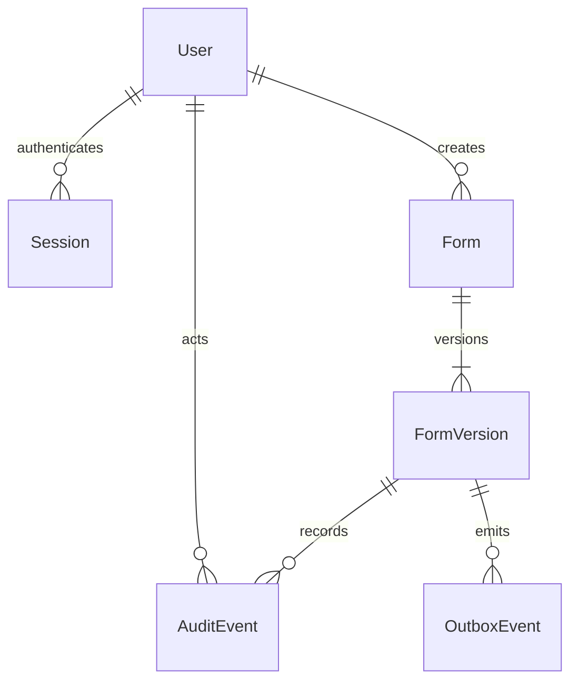

# Initial authoring data model

Implemented slice only; employee/case/response/assets/exit entities from the roadmap are not yet migrated. Generated identifiers are UUIDs. Record timestamps use `timestamptz`; the API returns UTC ISO timestamps.

User/session and form/version relations are enforced foreign keys. Creator/actor/target relationships are immutable provenance IDs; audit/outbox targets are polymorphic and deliberately do not cascade-delete with domain records. Actors are derived from active authenticated sessions, never accepted from mutation bodies.

| Entity | Stored purpose / constraints |
|---|---|
| User | Unique synthetic email, local role and active state; runtime SELECT only |
| Session | Hashed opaque session token, CSRF hash, user link, expiry; indexed user/expiry |
| Form | Stable identity, creating actor, creation date; versions share this ID |
| FormVersion | Unique `(formId, version)`, positive revision, recipient, title/instructions, JSON fields, Draft/Published, publication timestamp; revision compare-and-swap |
| AuditEvent | Actor/action/target, minimal version/revision metadata and timestamp; append-only runtime permissions |
| OutboxEvent | Committed action/target/time, unprocessed until a suitable handler exists |

Publishing validates the stored schema, atomically transitions only the expected draft revision, and records audit/outbox evidence. A database trigger prevents updates/deletes once published. New-version creation locks the parent form, checks the current latest version, and returns the same existing draft if concurrent requests race. This prevents duplicate version allocation.

JSON fields currently support basic questions, choices, consent checkbox, attachments and signature settings. Conditional rules, sections/repeating groups, sensitivity configuration and respondent assignments remain on the tracker. JSON is structured by the allowlisted shared Zod schema, not arbitrary executable configuration.

Future signature storage: the owner selected private object storage for signature images and signed PDFs. PostgreSQL will store a separate evidence record linking the stable private object key/file version, signer, immutable form/response and consent versions, signing method/timestamp, validated MIME/byte count and checksum. This entity is not yet migrated. Normalise/compress before signing confirmation and never overwrite confirmed evidence. Generate short-lived links only after checking actor/record permissions; do not persist expiring URLs, image Base64 or image bytes in form definitions, database evidence, lists or audit logs.
