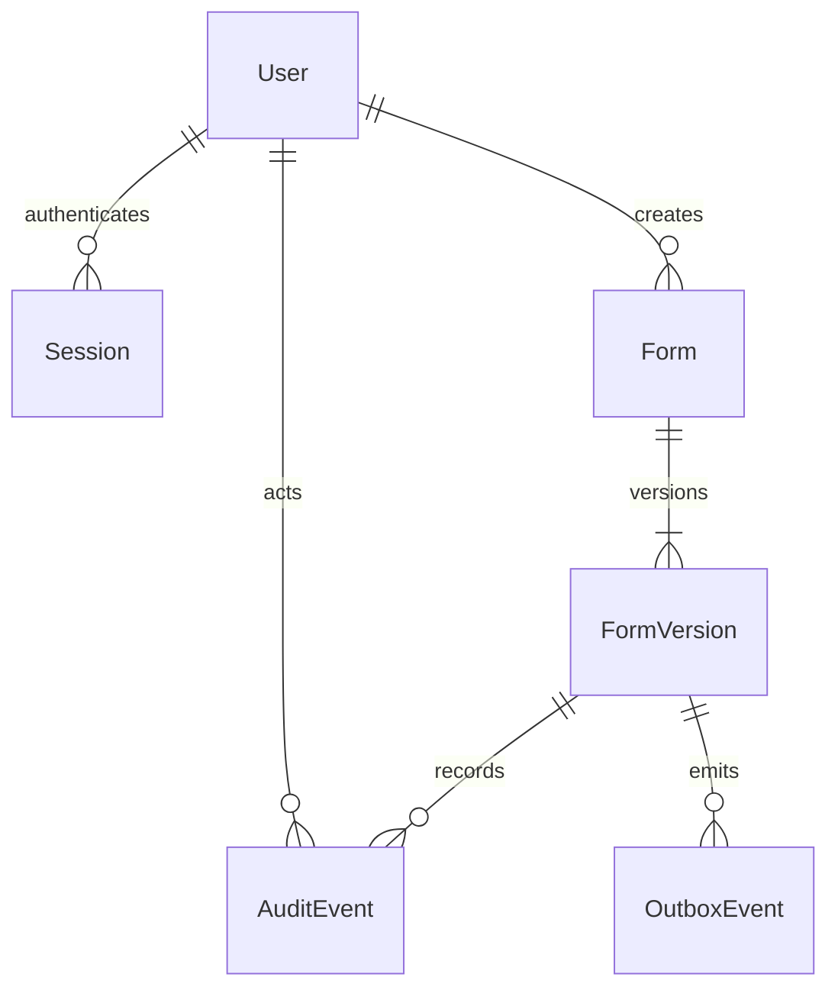

# Initial authoring data model

Implemented slice only; employee/case/response/assets/exit entities from the roadmap are not yet migrated. Generated identifiers are UUIDs. Record timestamps use `timestamptz`; the API returns UTC ISO timestamps.

User/session and form/version relations are enforced foreign keys. Creator/actor/target relationships are immutable provenance IDs; audit/outbox targets are polymorphic and deliberately do not cascade-delete with domain records. Actors are derived from active authenticated sessions, never accepted from mutation bodies.

| Entity | Stored purpose / constraints |
|---|---|
| User | Unique account email, application role and active state; runtime SELECT only |
| Session | Hashed opaque session token, CSRF hash, user link, expiry; indexed user/expiry |
| Form | Stable identity, creating actor, creation date; versions share this ID |
| FormVersion | Unique `(formId, version)`, positive revision, recipient, title/instructions, JSON fields, Draft/Published, publication timestamp; revision compare-and-swap |
| AuditEvent | Actor/action/target, minimal version/revision metadata and timestamp; append-only runtime permissions |
| OutboxEvent | Committed action/target/time, unprocessed until a suitable handler exists |

Publishing validates the stored schema, atomically transitions only the expected draft revision, and records audit/outbox evidence. A database trigger prevents updates/deletes once published. New-version creation locks the parent form, checks the current latest version, and returns the same existing draft if concurrent requests race. This prevents duplicate version allocation.

JSON fields currently support basic questions, choices, consent checkbox, attachments and signature settings. Conditional rules, sections/repeating groups, sensitivity configuration and respondent assignments remain on the tracker. JSON is structured by the allowlisted shared Zod schema, not arbitrary executable configuration.

Future signature storage: the owner selected private object storage for signature images and signed PDFs. PostgreSQL will store a separate evidence record linking the stable private object key/file version, signer, immutable form/response and consent versions, signing method/timestamp, validated MIME/byte count and checksum. This entity is not yet migrated. Normalise/compress before signing confirmation and never overwrite confirmed evidence. Generate short-lived links only after checking actor/record permissions; do not persist expiring URLs, image Base64 or image bytes in form definitions, database evidence, lists or audit logs.

## Identity/session extension

Migrations `202610130002_identity_sessions` and `202610130003_access_version` add explicit issuer/subject identity links, browser-bound OIDC attempts and versioned sessions. `User` has separate extra permissions and an access version; a database trigger increments it on role/permission/active changes. `Session` stores authentication method, accepted MFA evidence, access-version snapshot, creation/last-seen/absolute-expiry and revocation timestamps. Tokens remain hashed. `OidcAttempt` stores state/browser hashes, nonce and temporary verifier; consuming the attempt atomically erases the verifier. Identity/session foreign keys and lookup/expiry indexes are included. Runtime identity/user access is read-only; attempts/sessions have scoped operational grants. API/seed connections explicitly set UTC to prevent driver/session timezone shifts.

See [identity controls and permission matrix](IDENTITY.md). Production subject provisioning and role membership approval remain pending.

## Real Supabase Auth extension

Migration `202610130004_supabase_auth` adds encrypted provider-session data to Session and expiring encrypted AuthFlow rows for PKCE email, MFA and recovery state. All new exposed tables have RLS and backend-only grants. Old LOCAL/OIDC sessions are retired; previous fixture accounts are inactive. The retained OidcAttempt table is historical and is no longer used by the API.

Hosting-specific SQL in `database/supabase-auth-provisioning.sql` defines private owner-only bootstrap state, an auth.users trigger that provisions EMPLOYEE identities, and a backend-only active-provider-session boolean function. User-editable metadata cannot grant roles. Provider tokens are encrypted with AES-256-GCM; the browser stores neither access nor refresh tokens. See [identity setup](IDENTITY.md).

## Employee response extension

Review migrations 008/009 add immutable SubmissionReview decisions and AssignmentReviewAccess (one explicitly classified initial reviewer assignment per form assignment). Foreign keys preserve actor links. Backend-only RLS/grants protect the tables; sensitivity checks consult current account permissions. Database guards bind review transitions to the exact latest pending submission in an active case and preserve earlier evidence. Repeated corrections create successive FormSubmission versions. See [review contract and boundaries](REVIEWS.md).

Migration 007 adds EmployeeResponse (one revision-checked saved draft/status per assignment) and FormSubmission (immutable answers, exact assigned form version, actor/time, source revision and idempotency key). Composite foreign keys prevent a submission from referencing a different form version. Database guards reject submitted-response changes, incorrect employee actors, third-party proxy responses and immutable-history mutation. Audit/outbox commit with each accepted save/submission. See [response behavior and limits](RESPONSES.md).

## Employee invitation extension

Migration 006 adds EmployeeInvitation and InvitationDelivery, with request-key idempotency, one current invitation per employee, expiry/revocation/acceptance evidence and leased delivery attempts. Both tables have backend-only grants and RLS. The outbox permits updating only its operational processedAt field. A private backend-only boolean function determines whether invitation activation needs initial password setup; it exposes no password hash. See [invitation workflow](INVITATIONS.md).

## Employee onboarding extension

Migration 005 adds Employee, OnboardingCase and FormAssignment. Employee stores employment details, a revision and an optional unique verified-account link. OnboardingCase belongs to an employee; a partial unique index permits one active case. FormAssignment belongs to a case and references an exact published FormVersion through a composite form/version foreign key. A trigger rejects unpublished assignments and all assignment updates/deletes. Case/form uniqueness prevents duplicates. Runtime permissions permit employee/case reads, inserts and updates, and assignment reads/inserts; public API roles receive no table access. Private verified-email lookup/linking SQL handles registration before or after HR profile creation, without transferring a previously linked profile. See [onboarding acceptance](ONBOARDING_SLICE.md).
