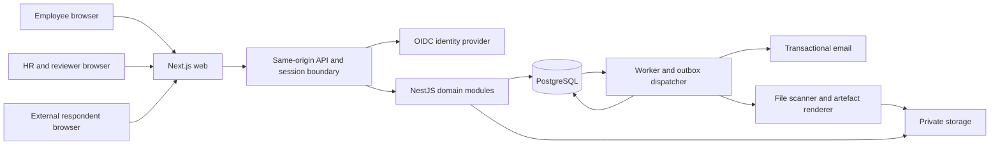

# NOLT HR Employee Lifecycle Portal — delivery roadmap

Prepared 13 October 2026. **Status: local implementation approved 13 October 2026; see ../TRACKER.md.**

Source: [original PRD](../source/NOLT_HR_Employee_Lifecycle_Portal_Full_PRD%20%283%29.pdf), v1.0, 9 September 2026, all 29 pages. Page numbers below refer to PDF pages. The PRD itself is a stakeholder-review draft. The underlying policy manual, legal agreements, AXA workbook and original forms were not separately supplied or verified; their exact text and field layouts must be obtained before their modules are finalised.

The owner approved local application implementation on 13 October 2026. Cloud provisioning and production deployment remain unapproved. Follow [the implementation tracker](../TRACKER.md) for verified progress. Unresolved business decisions remain tracked separately.

## Confirmed owner amendments

Use **shadcn/ui**. HR creates and publishes forms, upload/signature requirements and recipient assignments through a responsive builder in the core release. Employees send requests to guarantors; guarantors alone complete/sign their own responses. All portals and the builder adapt across screen sizes. Read [FORM_BUILDER.md](FORM_BUILDER.md) for the binding detail and acceptance scenarios. These owner requirements supersede the earlier seeded-template/editor deferral; local implementation is now approved.

## 1. Delivery outcome and scope

Deliver one secure portal with three experiences: employee self-service, HR/reviewer operations, and narrowly scoped external guarantor/reference requests. HR must be able to invite an employee, collect and review each requirement, request corrections with reasons, complete induction, retain evidence, issue assets, and eventually close an exit case.

Follow the PRD releases: core onboarding → NOLT workflows 2A → benefits/induction/assets 2B → offboarding. Security, audit, data versioning and reliable notification foundations belong in the first release. Payroll, recruitment before offer acceptance, leave, performance and attendance remain out of scope (p4). HMO exports support HR administration; this project does not replace AXA systems or assume a direct AXA API exists.

Build **vertical slices**: each milestone delivers screens, API, persistence, permissions and acceptance checks together. A polished mock dashboard with no working review workflow does not satisfy an MVP milestone.

## 2. Proposed architecture and technology decisions

The PRD leaves the stack open (p22). These are recommendations for approval, not existing infrastructure or mandated product requirements.

| Layer | Proposed choice | Responsibility |
|---|---|---|
| Web | Next.js App Router, React, TypeScript | Responsive employee, HR and external-request interfaces |
| UI | shadcn/ui + Tailwind CSS | Consistent form controls, tables, status labels, navigation and dialogs |
| Forms | React Hook Form; versioned validation schemas | Drafts, conditional questions, repeating beneficiary/dependent rows |
| API | NestJS modular monolith, REST `/api/v1`, OpenAPI | Sole authority for permissions, workflow transitions and validation |
| Data | PostgreSQL with Prisma migrations/query layer | Relational records, immutable submissions, decisions, audit and transactional outbox |
| Authentication | Managed OIDC provider supporting email login and privileged MFA | Authentication and recovery; provider selected at foundation gate |
| Session boundary | Same-origin API with server-managed secure sessions | Keep identity tokens out of browser storage; enforce CSRF on mutations |
| Documents | Private S3-compatible object storage | Quarantine uploads, protected originals and completed agreement artefacts |
| Async processing | Worker service consuming transactional outbox/jobs | Email, scanning, exports, scheduled reminders and artefact rendering |
| Email | Transactional provider selected for NOLT domain | Invitations and status messages; signed delivery webhooks |
| Quality | Unit/integration tests and Playwright user journeys | Workflow, isolation, contracts and accessible completion |
| Operations | Containerised services; managed database/storage; CI | Staging/production separation, monitoring, backups and controlled releases |

Use a modular monolith first: identity, employees, requirements, submissions, reviews, documents, external requests, agreements, benefits, induction, assets, offboarding, reporting, notifications and audit. A separate worker can share domain code. Microservices would add deployment complexity without a demonstrated need.

Suggested repository structure after approval:

```text
apps/web/                Next.js portals
apps/api/                NestJS API and identity/session boundary
apps/worker/             asynchronous jobs
packages/api-client/     generated from OpenAPI
packages/ui/             shared accessible controls
packages/domain/         shared identifiers and pure domain rules
packages/form-schemas/   versioned schemas without secret/business data
database/                migrations and synthetic seed data
tests/e2e/               complete journeys
docs/                    approved plans, contracts, decisions and runbooks
skills/nolt-hr-delivery/  reusable delivery instructions
```

Do not pin framework versions in this planning document. At scaffolding, select supported compatible releases, record runtime and lockfile, and verify provider support. The final hosting location, costs, identity provider, email vendor and operational owner are decision gates rather than implied purchases.

Technical references consulted: [Next.js server/client boundaries](https://nextjs.org/docs/app/getting-started/server-and-client-components), [NestJS OpenAPI support](https://docs.nestjs.com/openapi/introduction), [PostgreSQL privileges](https://www.postgresql.org/docs/current/ddl-priv.html). These document capabilities; the stack selection is our architectural recommendation.

## 3. How everything connects



All frontend reads and mutations go through the permission-checked API. Never connect browsers directly to PostgreSQL or ship storage/provider credentials. Server-rendered web requests forward the authenticated session through the same API contract; they do not bypass business rules by querying tables themselves.

**Invitation:** HR creates an employee and case from a published template snapshot. A transaction stores the case, assigned requirements, audit event and invitation job. The worker sends an expiring activation link. Activation verifies recipient identity and consumes the invitation once; resend revokes prior tokens without duplicating employee records. Identity-provider calls occur through a retriable provisioning workflow, not inside a long database transaction.

**Draft and submission:** UI fetches the assigned schema/version and safe prefilled values. Draft saving accepts incomplete content but validates supported structure. Final submission performs server-side completeness and conditional validation, freezes a new submission version, moves the item to Submitted and writes audit/outbox events in one transaction. UI displays the returned authoritative status and refreshes checklist/progress.

**Review and correction:** an authorised reviewer claims or opens a submitted version. Approve or Changes Required targets that exact version and expected record revision. A missing rejection reason fails validation. Simultaneous/stale decisions return a conflict. Corrections create a new submission without modifying the original decision or evidence.

**Upload:** API issues a short-lived upload authorisation for a generated object key. Browser uploads to private quarantine storage; completion verifies key ownership, actual size/type and checksum, then queues scanning. Pending/failed/quarantined files cannot be downloaded for ordinary use or accepted as valid submitted evidence. An authorised download request returns a short-lived link only after access and scan checks. Worker expiry cleanup removes abandoned uploads according to the retention policy.

**External request:** employee/HR creates a request tied to one required guarantor/reference slot. Link contains an opaque high-entropy token; only its hash is stored. Exchange establishes a short-lived request session and removes the token from the visible URL. It grants no employee account access. Expiry/revocation, rate limits, recipient verification and resends are enforced server-side. Employee sees request status, not private respondent evidence by default.

**Notification:** committed domain events feed an outbox worker. Jobs have deduplication keys, bounded retries, backoff, delivery tracking and an operator-visible failed-job queue. A mail failure does not roll back an approved submission; it remains visible and retriable. Emails contain a portal link and safe summary, never health/banking data or attached HR evidence.

**Exports:** authorised HR requests a permitted export. Worker captures a consistent dataset, generates the provider file, stores it privately, then notifies HR. Authorisation is checked again at download. Export records carry schema version, requester, filters, creation/expiry and audit evidence. AXA column/order mapping is validated against the supplied workbook, not guessed.

## 4. Frontend screen and interaction roadmap

| Experience | Screens/features | First delivery |
|---|---|---|
| Shared access | Login, activation, expired/revoked link, recovery, HR MFA, forbidden, session expiry | Foundation/MVP |
| Employee home | Current lifecycle stage, mandatory completion, next actions, due dates, correction reasons | MVP |
| Checklist | Assigned requirements with status, owner, due date and relevant action | MVP |
| Form workspace | Biodata sections, education, next of kin, emergency contact, restricted health/financial sections, background declarations | MVP |
| Document workspace | Configurable slots, upload progress/retry, safe preview/download, review history, replacement versions | MVP |
| HR dashboard | Active cases, employee action, review queue, corrections, upcoming starts, overdue requirements | MVP baseline; richer reports in 2B |
| HR employee record | Create/invite, employment details, assigned requirements, submission review, timeline, stage actions | MVP |
| HR review queue | Authorised pending items, preview, approve, request correction, mandatory reason, stale-decision recovery | MVP |
| Templates/settings | Versioned requirements, mandatory/optional rules, authorised waiver, file configuration, roles | HR form builder/editor in MVP; reporting refinements in 2B |
| External requests | Employee contact slots/status; respondent details, undertaking, evidence and secure resume | 2A |
| Agreements/policies | Versioned reader, acknowledgement, required signatory sequence and immutable completion | 2A |
| Benefits | Beneficiary allocations/guardian; HMO consent, enrolment and dependent rows | Beneficiary 2A; HMO 2B |
| Induction | Facilitator tasks, employee confirmation and authorised certification | 2B |
| Assets | Catalogue, issue details/condition, receipt acknowledgement, current assignments | 2B |
| Reports/activity | Status, ageing, coverage, induction/assets, AXA export; scoped notifications/history | 2B |
| Offboarding | HR case initiation, employee handover, asset returns, departmental clearance, interview and closure | 3 |

Design mobile-first employee completion and efficient desktop HR review. Every screen must handle loading, empty, validation, forbidden, expired-session, failed-network and retry states. Preserve drafts across navigation and warn on unsaved work. Review reasons remain attached to the relevant item. Use keyboard navigation, visible focus, labelled fields, error summaries, contrast and status text rather than colour alone (p20).

No health/financial data in generic dashboard payloads, client analytics or shared caches. Clearing a session clears user-specific query caches. External pages have no third-party tracking or token-bearing referrers.

## 5. Backend model and workflow rules

Logical design below is a planning baseline. Detailed field dictionaries, migrations and ERD are foundation deliverables, not existing database objects.

| Domain | Records and relationships |
|---|---|
| Identity/access | User maps provider subject to local user; roles, permissions and reviewer scopes; employee account linked separately |
| Employment | Employee belongs to department/employment type; employment history and cases survive account deactivation |
| Case/templates | TemplateVersion contains requirement definitions; OnboardingCase snapshots selected version; AssignedRequirement belongs to case |
| Forms/review | Draft is mutable; SubmissionVersion is frozen; ReviewDecision references exact submitted version; history is append-only |
| Files | DocumentVersion references requirement/submission, object key, checksum, uploader, MIME/size, scan status and version |
| Sensitive sections | Health, bank/pension/tax and background content separated from general employee records and serialised through restricted DTOs |
| Respondents | ExternalRequest belongs to employee and required slot; token/session state, response versions, evidence and review decisions |
| Policies/legal | PolicyVersion/AgreementVersion, Acknowledgement, AgreementInstance, ordered SignatoryStep and immutable completion artefact |
| Benefits | NominationVersion has beneficiary rows and guardians; HMOEnrollmentVersion has member/dependent rows and consent evidence |
| Induction | ChecklistVersion, assigned tasks, facilitator completion and separate employee/HR signatures |
| Assets | Asset catalogue and uniquely identified inventory; AssetAssignment stores quantity/issue condition/acknowledgement and return evidence |
| Exit | OffboardingCase, handover versions, clearance tasks, return links, approved exceptions and interview |
| Reliability | AuditEvent, Notification, transactional OutboxEvent, JobAttempt, ExportJob and retention/deletion job records |

Keep foreign keys and unique constraints for identities, case item assignments, version numbers and idempotency keys. Index foreign keys and queue/directory filters after checking query patterns. Use UTC timestamps; display dates in Africa/Lagos; dates of birth, start dates and last working days are calendar dates. Preserve account/tax/phone identifiers as strings. Percentages use exact decimal arithmetic, not binary floats. Sensitive fields never become searchable unrestricted text.

Application connections use a restricted non-superuser database role; migration credentials are separate. Enforce record ownership, role, module and sensitivity permissions in the API. PostgreSQL row policies may add defence in depth if identity context is safely transaction-scoped with connection pooling; they are not a substitute for API checks. No destructive cascade from employee/account deletion into audit or signed evidence. Implement retention and lawful deletion rules only after approval, including stored files and backups.

### State machines and completion

Requirement path (p6/p29): Not Started → Draft → Submitted → Under Review → Approved. Correction path: Under Review → Changes Required → Resubmitted → Under Review. Agreements additionally use Awaiting Employee, Awaiting Guarantor/Witness, Awaiting NOLT Signatory and Completed. Waived and Not Applicable are authorised reason-bearing dispositions; historical decisions are retained when a requirement is reopened.

The API owns transitions; clients cannot PATCH arbitrary status values. Approvals cannot be edited in place. A correction to an approved item starts a new version/review cycle under explicit authority. Case completion or readiness checks must use current active versions, not an old approval.

**Proposed progress formula for HR approval:** denominator = mandatory assigned requirements excluding authorised Not Applicable; numerator = those in Approved/Completed or expressly Waived. Optional items do not affect the percentage. Show waived and not-applicable counts separately. If denominator is zero, show “No mandatory items assigned” and require explicit HR readiness confirmation rather than automatically claiming 100%. Submission alone does not count as approval. This resolves a detail not fully specified by BR-05.

**Case stage versus overall status:** store lifecycle stage independently from derived operational status. A case can be Pre-Onboarding with Action Required or HR Review. Suggested precedence within an active stage: Changes Required → Action Required; otherwise any pending review → HR Review; otherwise stage label. Explicit HR actions confirm Ready to Resume, resumption, onboarding closure and exit. Status precedence is a proposal, not a quoted PRD rule.

Pre-start readiness checks only mandatory pre-start items. Onboarding completion checks all mandatory onboarding/induction items, agreements and required sign-offs. Reopening a completed item must explicitly update case readiness/completion according to approved HR policy, not silently leave an invalid completed case.

Induction completion requires all mandatory tasks plus employee and authorised HR/Operations confirmation (p11). Exit clearance requires each expected asset return or approved exception (BR-11). An exit-account deactivation policy must state timing, session revocation and whether employee handover access continues before closure.

## 6. Phased implementation backlog and acceptance gates

Estimates are indicative **engineering person-weeks**, including frontend/backend integration and automated verification. They assume a full-time experienced frontend engineer and backend engineer with regular HR decisions, plus shared design/QA/operations support. They are not calendar promises or AI execution estimates. Vendor lead times and waiting for legal/HR are excluded. Re-estimate after foundation contracts and source forms are available.

| Milestone | Effort | Frontend work | Backend/API and connection work | Exit gate |
|---|---:|---|---|---|
| M0 — decisions/design/contracts | 3–4 | Employee/HR/external wireframes, navigation, form/error patterns | Permission matrix, dictionary/ERD, OpenAPI baseline, threat/data-flow review, hosting/auth decisions | Approved scope, roles and core interaction prototype; missing source artefacts logged |
| M1 — secure foundation | 3–4 | Login/activation/recovery/MFA; portal shells | Monorepo, CI, local services, identity/session adapter, permissions, migrations, audit/outbox, worker and storage/email adapters | Real authenticated user reaches only authorised portal; tests run in CI; no real employee data |
| M2 — employee/case invitation | 2–3 | HR create/directory/record; employee home/checklist | Employee creation, template snapshot, secure invite/resend, checklist/progress and basic notifications | Invite → activate → own assigned checklist works end to end; no duplicates on retry |
| M3 — forms/documents | 8–11 | HR form builder/publish/preview, signature capture/attachments, dynamic biodata/background forms, drafts, conditional fields, evidence slots/upload progress | Versioned authoring/assignment, signature evidence, schemas, restricted sections, drafts/submissions, private upload/scan/download, immutable versions | Draft/reopen and submit work; unsafe files blocked; employee A cannot retrieve B’s data/files |
| M4 — review and core pilot | 4–5 | Review queue, reasons/resubmit, timeline, HR stage actions | Decision transactions, conflicts, waivers, notifications, readiness guards and baseline exports | HR-authored signed form and full correction cycle pass; core P0 checks pass; HR signs off limited Phase 1 pilot |
| M5 — Phase 2A | 5–7 | Guarantor/reference request workspace; policy/agreement reader/signing; beneficiaries | Scoped respondent sessions, replacement/review; immutable policy acknowledgements; signatory stages; allocation/guardian validation | Expired/replaced requests fail safely; historical versions survive; only complete signatory chains lock agreements |
| M6 — Phase 2B | 4–6 | HMO/dependents, induction, assets, reports/settings | AXA mapping/export, dual induction sign-off, assignment acknowledgements, report queries and configurable reminders | Approved AXA workbook comparison; induction gates hold; issued assets persist into employee record |
| M7 — Phase 3 | 3–5 | Exit case, handover, return/clearance and interview | Exit guards, asset-derived return tasks, exceptions, departmental scopes, deactivation/session revocation | Outstanding asset blocks closure unless exception approved; exit history retained; closed user loses access |
| M8 — full-release readiness | 2–3 | Accessibility/mobile/browser fixes and production help text | Restore exercise, performance baseline, monitoring/alerts, deployment/rollback and support runbooks | HR/legal/operations go-live gates satisfied; representative pilot accepted |

Total provisional effort: **34–48 engineering person-weeks**. With two full-time engineers and shared support, a provisional planning range is roughly **22–32 calendar weeks**, allowing for dependencies and review; staffing changes alter this. M1–M4 core build is 17–23 person-weeks after M0. Every released phase needs a proportionate release gate; M8 is the final full-product readiness exercise, not the first time backups/security are checked.

Dependency spine: M0 → M1 → M2 → M3 → M4 → M5/M6 → M7 → M8. Once common foundations are stable, policy/benefits/assets modules can advance independently. Assets must exist before offboarding return tests. Approved legal text is required before agreement execution acceptance; exact AXA workbook is required before export acceptance.

At each milestone: demonstrate the integrated journey, update requirement coverage and decision log, run relevant checks, record evidence, then continue within approved scope. Phase 1 pilot is **core onboarding**, not a claim that full PRD induction/legal/guarantor functionality is complete.

### PRD inconsistency to resolve explicitly

Page 27 describes later induction completion within the “MVP definition of done”, while pages 2/23 put full induction in Phase 2/2B. This plan follows the explicit release table: Phase 1 covers core onboarding; Phase 2B delivers full induction. HR must confirm this interpretation before approving a release scope. If full induction is required for MVP, pull that work from M6 into M4 and re-estimate.

## 7. Testing, security and operations

Use server-side domain tests for state transitions, readiness/progress, conditional declarations, beneficiary totals/minors, signatory order and exit guards. Use real PostgreSQL integration tests for transactions, permission-scoped queries, uniqueness, optimistic concurrency and outbox retries. API contract checks verify payloads match generated frontend types. E2E tests cover invitation, draft restore, submission/correction, external expiry, policy versions, AXA export, induction and asset-to-exit continuity (p24).

Negative tests must exercise direct API requests, not just hidden buttons: employee A accessing B, general reviewer fetching sensitive sections, unassigned reviewer deciding a submission, technical admin reading HR content, external session fetching another request, download without permission, revoked/expired session, malicious MIME/size and stale approval. Include export/download permissions and private storage configuration.

Proposed performance targets for approval: p95 core read API under 500ms at an agreed representative dataset/load; p95 ordinary page usability within 2.5s on the chosen test network/device; upload progress stays visible. Confirm volumes and file limits before treating these as acceptance thresholds. Large exports remain asynchronous.

Operational environments: local → staging with synthetic fixtures → production. Secrets remain in server secret stores, never repository files. Production enables TLS, privileged MFA, secure cookies, CSRF, scoped rate limits, redacted logs, error monitoring, worker failure alerts, storage access checks and malware scanning. Privileged MFA is a proposed release requirement consistent with p19's recommendation.

Use request/job correlation IDs, safe structured logs and latency/error/queue metrics. Audit records capture actor, action, target, version and safe before/after summaries; they must not copy full sensitive payloads, tokens or credentials. Export and restricted-data access are auditable. Ordinary roles cannot update/delete audit history; controlled retention follows approved policy.

Agree backup retention, recovery point/time objectives and incident owners; prove restoration into an isolated environment. Deployment uses checked migrations, compatibility-aware rollout and a rollback plan; never assume a database downgrade can undo a destructive migration. Email sender/domain, delivery failures, file scanner and identity recovery are tested before pilot.

## 8. Approval and unresolved decisions

**Roadmap approval needed now:** approve or amend the stack proposal, phased scope and the induction interpretation. Approval begins M0/local implementation; it does not declare legal wording or production hosting approved.

| Decision/input | Proposed working position | Needed by |
|---|---|---|
| Mandatory requirements by employment type and pre-start stage | Published Permanent/Contract/Other templates; HR approves actual rules | M0/M2 |
| Guarantor-family conflict | Configurable; do not enforce either conflicting rule as fact | Before Phase 2A production |
| Original forms, legal texts and versions | Obtain supplied originals; no invented signature/consent wording | Relevant form/2A/2B acceptance |
| Signing/witness execution | Policy/declaration acknowledgements; legal-approved agreement process; provider optional | M5 |
| Identity provider and login | Managed email-based login; MFA for privileged users | M0/M1 |
| Sensitive access groups and reviewer assignment | Separate health/finance permissions; no automatic technical-admin content access | M0/M1 |
| Hosting region, budget and existing NOLT services | Managed services where appropriate; no vendor purchase assumed | M0; final production approval |
| File types/limits/scanner | Configurable limits; private quarantine and scan-before-use | M3 |
| Progress and derived status precedence | Proposed formulas above; HR confirms edge cases | M2/M4 |
| Reminder cadence | Configurable; PRD example 7/3/1 days plus overdue, not silently enabled | M6 |
| AXA workbook/export owner | Approved rows only; HR initiates and securely downloads | M6 |
| Retention, privacy, correction/deletion, backups | HR/legal approve schedule and evidence handling | Before production pilot with real data |
| Exit access timing/department clearances | Configure from HR/IT policy; revoke active sessions at deactivation | M7 |
| Expected volumes, SLA, recovery and support | Agree measurable load/recovery targets and named owners | Foundation; prove before go-live |

Open choices must be configuration or clearly labelled provisional behaviour in development. Do not let an unresolved production blocker prevent building independent modules with synthetic test data.

## 9. Deliverables and handoff

This planning package includes this roadmap, [API and connection plan](API_AND_CONNECTIONS.md), [PRD traceability and acceptance](TRACEABILITY.md), [decision log](DECISIONS.md), the extracted page-labelled PRD, and the reusable [delivery skill](../../skills/nolt-hr-delivery/SKILL.md).

After approval, M0 produces detailed wireframes, ERD, field dictionary, versioned form inventory and executable OpenAPI specification. Later milestones deliver source code, migrations, synthetic seeds, integrated tests, release evidence, provider setup instructions and operational runbooks. A roadmap/API inventory is not a completed implementation or a deployed backend.
